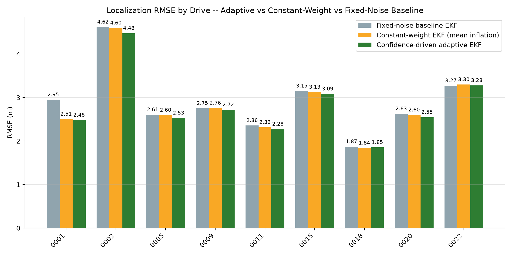
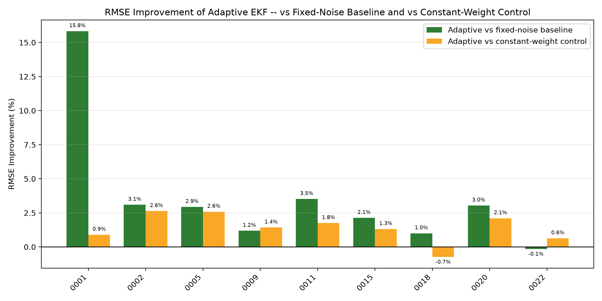
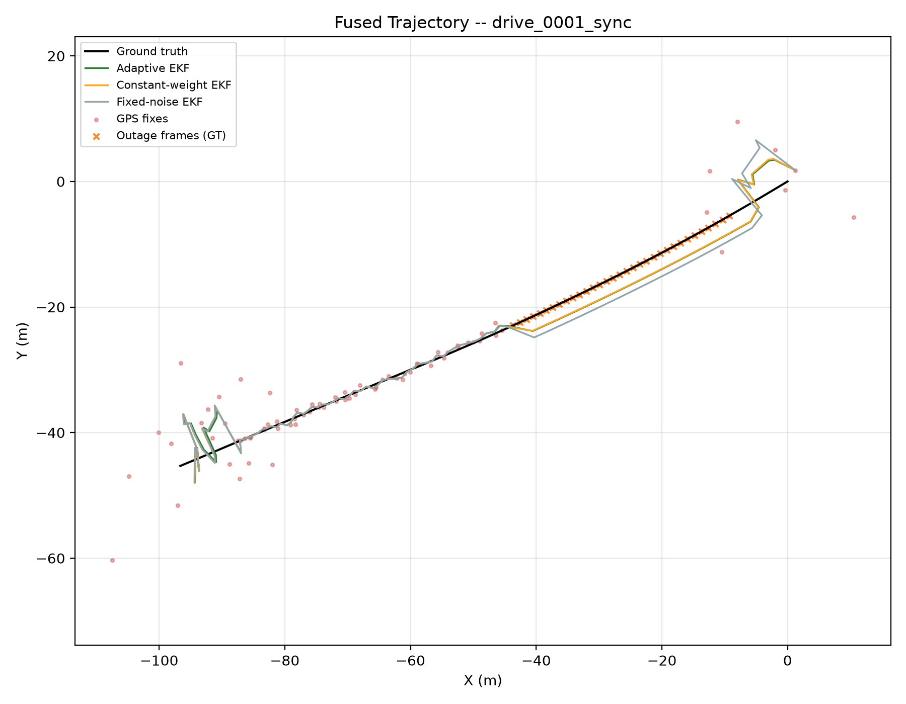
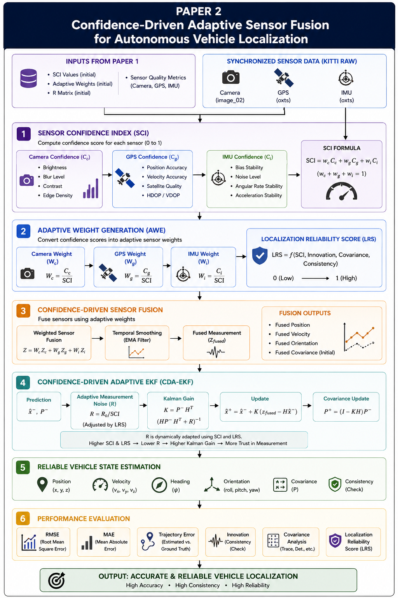

# CAMSF — Confidence-Driven Adaptive Multi-Sensor Fusion Framework

> **Confidence-Driven Adaptive Multi-Sensor Fusion Framework for Robust Autonomous Vehicle Localization**
>
> **Author:** Kokkireni Vishwa (23261A0590) · Department of CSE, Mahatma Gandhi Institute of Technology (A), Hyderabad
> **Guide:** Dr. P. Poornima, Assistant Professor, Department of CSE
> **Dataset:** KITTI Raw (synchronized sequences, 2011_09_26)

CAMSF is a localization framework for autonomous vehicles that **estimates how reliable each sensor is, frame by frame, and uses that reliability to decide how much each sensor should influence the position estimate**. It fuses camera, GPS and IMU data from KITTI Raw. When a sensor degrades, for example when GPS suffers multipath noise or drops out, the framework lowers that sensor's trust automatically. It keeps the trajectory continuous and predicts how large the localization error is likely to be.

---

## Contents

- [Highlights](#highlights)
- [Results](#results)
- [Framework architecture](#framework-architecture)
- [Method](#method)
- [Repository structure](#repository-structure)
- [Getting started](#getting-started)
- [Reproducing the results](#reproducing-the-results)
- [Paper and documentation](#paper-and-documentation)
- [Evaluation protocol](#evaluation-protocol)
- [Limitations and future work](#limitations-and-future-work)
- [Citation](#citation)

---

## Highlights

- **Sensor Quality Assessment** of every frame:
  - Camera: 7 image-quality metrics.
  - GPS: stability, satellite and accuracy scores.
  - IMU: motion smoothness and angular stability.
- **Sensor Confidence Index (SCI):** one normalized `[0, 1]` measure of the overall sensing condition.
- **Adaptive Weight Estimation:** per-frame, normalized camera/GPS/IMU weights. They are based on each sensor's confidence and on how steady that confidence is over time.
- **Confidence-Driven Adaptive EKF (CDA-EKF):** confidence-scaled measurement and process noise, explicit GPS-outage handling (IMU dead-reckoning) and a Joseph-form covariance update.
- **Localization reliability prediction:**
  - Models: Linear Regression, Gradient Boosting and Random Forest.
  - Inputs: 37 pre-fusion features chosen so that no ground-truth information leaks into them.
  - Evaluation: leave-one-drive-out cross-validation.
- **Reproducible evaluation:**
  - GPS degradation is injected from a fixed random seed.
  - The ground truth is independent of the measurements.
  - The baseline is a genuine fixed-noise EKF.

---

## Results

Results cover **9 KITTI drives and 2,472 frames**. The seeded GPS degradation labels 1,373 frames healthy, 722 degraded and 377 as complete outages. All errors are measured against the pristine OXTS ground truth.

### Localization (adaptive EKF vs. baselines)

| Drive | Frames | Adaptive RMSE (m) | Fixed-noise baseline RMSE (m) | Constant-weight RMSE (m) | RMSE improvement |
|:-----:|:------:|:-----------------:|:-----------------------------:|:------------------------:|:----------------:|
| 0001 | 108 | **2.48** | 2.95 | 2.51 | **15.8 %** |
| 0002 | 77  | **4.48** | 4.62 | 4.60 | 3.1 % |
| 0005 | 154 | **2.53** | 2.61 | 2.60 | 2.9 % |
| 0009 | 447 | **2.72** | 2.75 | 2.76 | 1.2 % |
| 0011 | 233 | **2.28** | 2.36 | 2.32 | 3.5 % |
| 0015 | 297 | **3.09** | 3.15 | 3.13 | 2.1 % |
| 0018 | 270 | 1.85 | 1.87 | **1.84** | 1.0 % |
| 0020 | 86  | **2.55** | 2.63 | 2.60 | 3.0 % |
| 0022 | 800 | 3.28 | **3.27** | 3.30 | −0.1 % |
| **Pooled** | **2472** | **2.89** | 2.94 | 2.92 | **1.8 %** |

- The adaptive filter beats the fixed-noise baseline in **8 of 9 drives**.
- The largest gain, **15.8 %**, is on drive 0001, which has the longest GPS outage (33 frames).
- The trajectory stays continuous through every outage.

### Localization reliability prediction (leave-one-drive-out, pooled)

| Model | RMSE (m) | MAE (m) | R² |
|:------|:--------:|:-------:|:--:|
| **Random Forest** | **1.76** | 1.05 | **0.42** |
| Gradient Boosting | 1.78 | **1.05** | 0.41 |
| Linear Regression | 2.00 | 1.25 | 0.25 |

The dominant predictors are GPS position stability and the GPS step distance between consecutive frames.

| Per-drive RMSE | RMSE improvement | Trajectory (drive 0001) |
|:---:|:---:|:---:|
|  |  |  |

---

## Framework architecture



```
KITTI Raw (Camera + GPS/OXTS + IMU)
        │  validation: completeness · timestamps · frame consistency · availability
        ▼
Seeded GPS degradation  ──►  degraded GPS fixes (measurement)  +  pristine OXTS (ground truth)
        │
        ├── Camera Quality ─► Camera Confidence
        ├── GPS Quality    ─► GPS Confidence ─┐
        └── IMU Quality    ─► IMU Confidence ─┴► Sensor Confidence Index (SCI)
                                   │
                                   ▼
                 Adaptive Weight Estimation (w_cam, w_GPS, w_IMU)
                                   │
                                   ▼
          Confidence-Driven Adaptive EKF  (state x, y, yaw, v; Q, R scaled by weights)
                                   │
                                   ▼
     Leak-free feature table ─► ML reliability prediction (LR / GBR / RF, leave-one-drive-out)
                                   │
                                   ▼
              Evaluation: RMSE · MAE · final drift · R² · MAPE · trajectories
```

---

## Method

| Stage | What it does | Module |
|---|---|---|
| Camera quality | Brightness, contrast, Laplacian-variance blur, entropy, Canny edge density, dynamic range and noise, min–max normalized and combined into a weighted confidence | `camera_quality.py`, `quality_metrics.py`, `camera_confidence.py`, `confidence_metrics.py` |
| GPS quality | Position stability `exp(−dₜ/d̄)`, velocity and heading stability `1/(1+Δ)`, satellite availability, position and velocity accuracy | `gps_quality.py`, `gps_confidence.py` |
| IMU quality | Motion smoothness and angular stability from changes in the acceleration and angular-rate magnitudes | `imu_quality.py`, `imu_confidence.py` |
| SCI | `SCI = 0.6·C_GPS + 0.4·C_IMU`, which lies in `[0, 1]` | `imu_confidence.py` |
| Adaptive weights | Reliability `ρ = C·(1 − σ̃)` using a 5-frame rolling std; `w = ρ / Σρ` | `adaptive_weights.py` |
| CDA-EKF | Noise multiplier `m(w) = clip(1 + 6(1 − w), 1, 40)` applied to `R` (GPS) and `Q` (IMU and camera); the update is skipped during outages | `adaptive_ekf.py`, `adaptive_fusion.py` |
| GPS degradation | Healthy (σ = 0.5 m), degraded (σ = 8 m, 3–5 satellites) and outage segments of 6–25 frames, seed 42 | `gps_degradation.py` |
| ML reliability | 37 leak-free features → per-frame position error, evaluated leave-one-drive-out | `build_ml_dataset.py`, `ml_drive_holdout.py` |
| Reporting | Per-drive and pooled tables, bar charts and trajectory plots | `merge_results.py`, `results_summary.py` |

---

## Repository structure

```
CAMSF/
├── README.md
├── requirements.txt
├── dashboard.py                  # Streamlit dashboard for results and figures
├── Papper-2-arch.png             # Framework architecture diagram
├── paper/
│   ├── CAMSF_V2.pdf              # Research paper (latest)
│   ├── CAMSF_V2.docx             # Research paper, editable
│   ├── CAMSF_Presentation.pptx   # Presentation slides
│   └── fig*.png                  # Paper figures (earlier draft)
├── docs/
│   ├── CAMSF_Project_Stage1_Report.pdf   # B.Tech Project Stage-I report (CS753PC)
│   └── CAMSF_Project_Stage1_Report.docx
├── src/
│   ├── run_pipeline_fixed.py     # ▶ End-to-end corrected pipeline (per drive)
│   ├── gps_degradation.py        # Seeded GPS degradation + independent ground truth
│   ├── kitti_raw_dataset.py      # KITTI Raw loader (images, OXTS, calibration)
│   ├── camera_quality.py / quality_metrics.py
│   ├── camera_confidence.py / confidence_metrics.py
│   ├── gps_quality.py / gps_confidence.py
│   ├── imu_quality.py / imu_confidence.py      # IMU confidence + SCI
│   ├── adaptive_weights.py       # Adaptive Weight Estimation
│   ├── adaptive_ekf.py           # Confidence-Driven Adaptive EKF
│   ├── adaptive_fusion.py        # Adaptive / fixed-noise / constant-weight EKF runs + metrics
│   ├── merge_results.py          # Merge per-drive outputs → results/merged/
│   ├── build_ml_dataset.py       # Leak-free ML feature table
│   ├── ml_drive_holdout.py       # LR / GBR / RF with leave-one-drive-out evaluation
│   ├── results_summary.py        # Summary tables + figures
│   └── (legacy) run_pipeline.py, run_all_drives.py, train_final_model.py, evaluate_final_model.py, paper_results.py, ...
├── results/                      # Outputs of the corrected pipeline
│   ├── *_<drive>.csv             # Per-drive quality, confidence, weights, fusion, degradation
│   ├── merged/                   # Dataset-wide tables (incl. merged_localization_ml_dataset.csv)
│   ├── ml/                       # metrics_summary.csv, per_drive_holdout_metrics.csv
│   └── summary/                  # overall_summary.csv, per_drive_comparison.csv
├── figures/                      # Result figures
├── models/best_localization_model.joblib   # Random Forest re-fitted on all drives
├── notebooks/                    # Stage-by-stage exploration notebooks
├── tables/                       # Tables from the original (pre-correction) pipeline
├── refarence_Papers/             # Literature used in the survey
└── datasets/                     # Place KITTI Raw here (not tracked)
```

> **Note.** `results/`, `figures/per_drive_rmse.png`, `figures/rmse_improvement_by_drive.png`, `figures/feature_importance.png`, `figures/trajectory_*.png` and `models/` are produced by the **corrected pipeline**. Those are the numbers in the paper and report. The older figures in `figures/`, the files in `tables/` and the legacy scripts come from the original pipeline. That pipeline scored the filter against its own GPS input and split frames randomly for ML. It is kept only for reference.

---

## Getting started

### 1. Install

```bash
git clone https://github.com/vishwa-10147/CAMSF.git
cd CAMSF
python -m venv .venv
.venv\Scripts\activate          # Windows  (Linux/macOS: source .venv/bin/activate)
pip install -r requirements.txt
```

Python 3.10 or later is required (developed with Python 3.13).

### 2. Get the KITTI Raw data

Download the synchronized drives and the OXTS data for **2011_09_26** from the [KITTI Raw dataset](https://www.cvlibs.net/datasets/kitti/raw_data.php). The drives are 0001, 0002, 0005, 0009, 0011, 0015, 0018, 0020 and 0022. Place them like this:

```
datasets/KITTI/2011_09_26/
├── calib_cam_to_cam.txt ...
└── 2011_09_26_drive_0001_sync/
    ├── image_02/data/*.png
    └── oxts/data/*.txt
```

To keep the dataset elsewhere, pass `--dataset-root <path>`.

---

## Reproducing the results

Run from the repository root:

```bash
# 1. Full corrected pipeline for every drive (degradation → quality → confidence → SCI → weights → EKF)
python -m src.run_pipeline_fixed

#    ...or a single drive
python -m src.run_pipeline_fixed --drive 2011_09_26_drive_0001_sync

# 2. Merge per-drive outputs into dataset-wide tables
python -m src.merge_results

# 3. Build the leak-free ML dataset and run leave-one-drive-out evaluation
python -m src.build_ml_dataset
python -m src.ml_drive_holdout

# 4. Summary tables and figures
python -m src.results_summary

# 5. (optional) Interactive dashboard
streamlit run dashboard.py
```

Every random step uses a fixed seed (degradation seed 42, model `random_state` 42), so these commands reproduce the numbers above. Useful options include `--degradation-seed`, `--rolling-window` and `--no-figures`. Run any script with `--help` to see them all.

---

## Paper and documentation

| Document | File |
|---|---|
| Research paper — *Confidence-Driven Adaptive Multi-Sensor Fusion Framework for Robust Autonomous Vehicle Localization* | [`paper/CAMSF_V2.pdf`](paper/CAMSF_V2.pdf) · [`.docx`](paper/CAMSF_V2.docx) |
| Presentation | [`paper/CAMSF_Presentation.pptx`](paper/CAMSF_Presentation.pptx) |
| B.Tech Project Stage-I Report (CS753PC), MGIT, 2026 | [`docs/CAMSF_Project_Stage1_Report.pdf`](docs/CAMSF_Project_Stage1_Report.pdf) · [`.docx`](docs/CAMSF_Project_Stage1_Report.docx) |

The project report covers:

- the introduction, problem definition and objectives;
- the literature survey;
- the full design methodology with equations;
- the implementation;
- the experimental results and discussion;
- conclusions and future scope;
- source-code excerpts.

---

## Evaluation protocol

The evaluation was corrected so that its numbers are not inflated:

1. **No circular ground truth.** The EKF receives *degraded* GPS fixes and is scored against the *pristine* OXTS trajectory. In the earlier version, the filter was compared with the same GPS stream it consumed.
2. **A true baseline.** The baseline is a conventional EKF with fixed `Q` and `R`. A constant-weight EKF, which uses each sensor's mean weight, is also reported. It shows that the gain comes from frame-by-frame adaptation.
3. **Explicit outages.** During an outage no fix is fed to the filter, which dead-reckons on the IMU.
4. **Honest ML generalization.** Consecutive frames are strongly autocorrelated, so a random split inflated R² to about 0.94. Leave-one-drive-out evaluation gives R² ≈ 0.42 on unseen drives. Ground-truth and fused-output columns are excluded from the features.

---

## Limitations and future work

**Limitations**
- GPS degradation is simulated rather than recorded.
- The camera currently affects only the heading process noise; it does not provide a visual-odometry position measurement.
- All drives come from one recording day.

**Future work**
- Learned and temporal confidence models (RNNs, transformers).
- Probabilistic error prediction (e.g. NGBoost).
- Visual odometry measurements.
- LiDAR, radar and V2X inputs.
- Evaluation on real urban-canyon data and other datasets.
- Embedded real-time deployment.
- Explainable confidence.

---

## Citation

```bibtex
@article{vishwa2026camsf,
  title   = {Confidence-Driven Adaptive Multi-Sensor Fusion Framework for Robust Autonomous Vehicle Localization},
  author  = {Vishwa, K.},
  institution = {Department of Computer Science and Engineering, Mahatma Gandhi Institute of Technology (A), Hyderabad},
  year    = {2026}
}
```

### Acknowledgements

- Dr. P. Poornima, for guidance. Her work on GPS-spoofing detection in autonomous vehicular systems is the base of this project.
- The KITTI Vision Benchmark Suite (Geiger et al., IJRR 2013), for the dataset.
